# Using Someday

Someday is not a todo list. It is a slow-moving collection of things you would like to do or find out about *some day*, and a button that picks one for you when you have time.

## Give me something

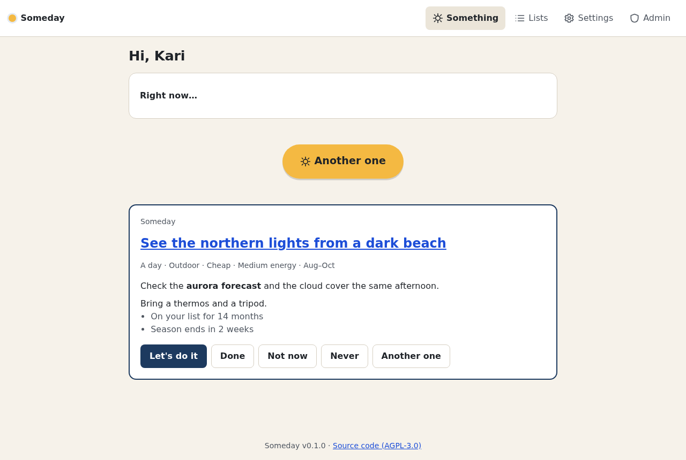

Tap **Give me something to do**. Someday picks an idea at random, favouring ideas that have waited long, ideas you planned, and ideas whose window is about to close. It always says why ("On your list for 14 months", "Season ends in 2 weeks").

Open **Right now…** to say what fits: how much time you have, indoor or outdoor, budget, energy, alone or together, and which lists to pick from. **Use as my default** saves the filters (nudges use them too).

What you can do with a suggestion:

- **Let's do it** marks it planned.
- **Done** logs it (see below).
- **Not now** hides it for a week (change the length in Settings → Suggestions).
- **Never** drops it (there is an Undo).
- **Another one** picks again, without repeating.

It works offline too: the same suggester runs on your device.

## Lists and ideas

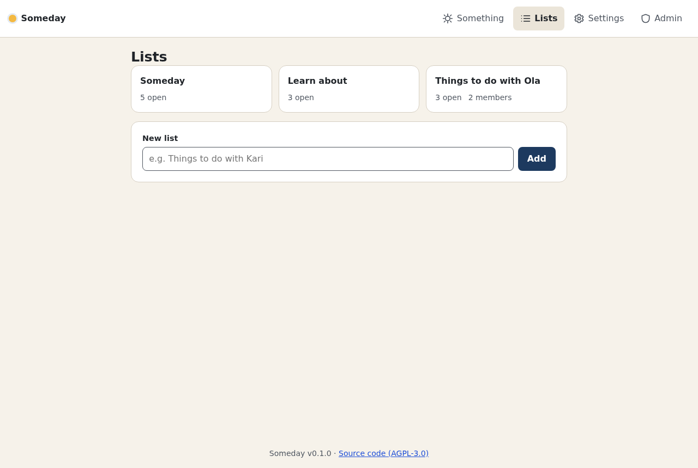

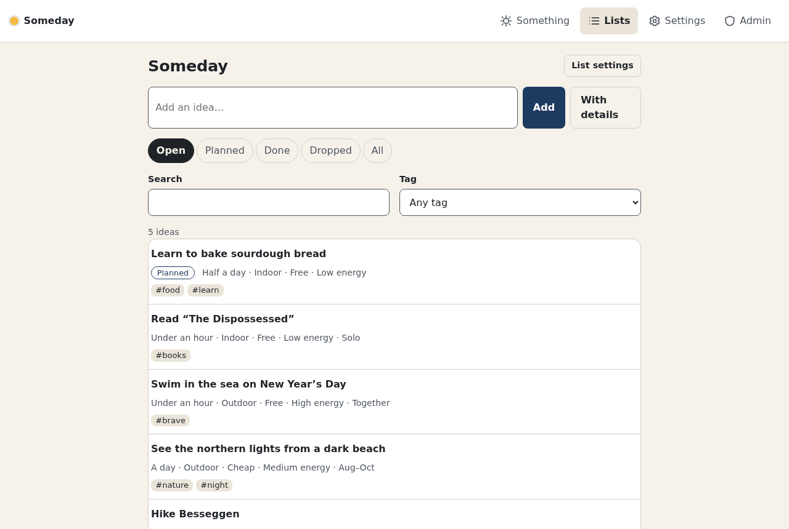

Type a title and press **Add**, or use **With details**. Everything except the title is optional, and anything left unset fits every filter:

- time it takes, indoor/outdoor, cost, energy, solo/together;
- a date window ("not after 2030") and/or a season (the months it is possible in, e.g. September–March for the northern lights);
- notes with simple formatting, links, a place and tags;
- **repeatable** for things worth doing again and again.

Use the tabs, search and tag filter to find things. Changes you make offline are kept on the device and sent when you are back online.

## Done, and who sees it

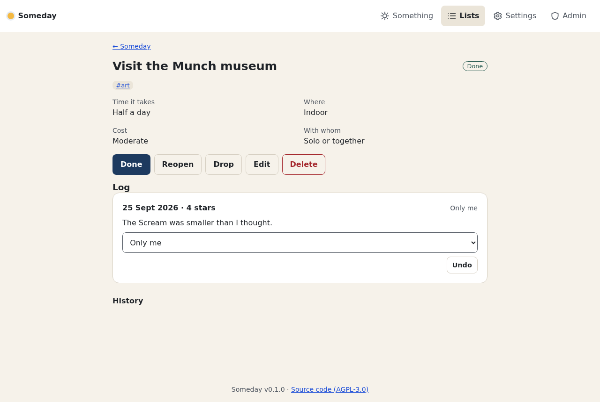

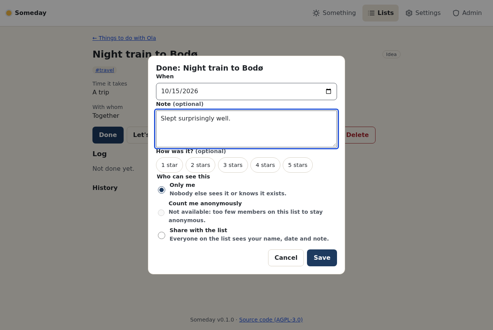

**Done** records when you did it, with an optional note and rating. On a shared list, "done" is personal: the idea stays open for the others. You choose who sees the entry:

- **Only me** (default): nobody else sees it or knows it exists.
- **Count me anonymously**: others see how many have done it, not who. Only offered when the list is big enough (4 members by default) that a count cannot point at you.
- **Share with the list**: everyone sees your name, date and note.

**Undo** removes an entry. Editors can still mark an idea done or dropped *for everyone* from the idea page.

## Sharing a list

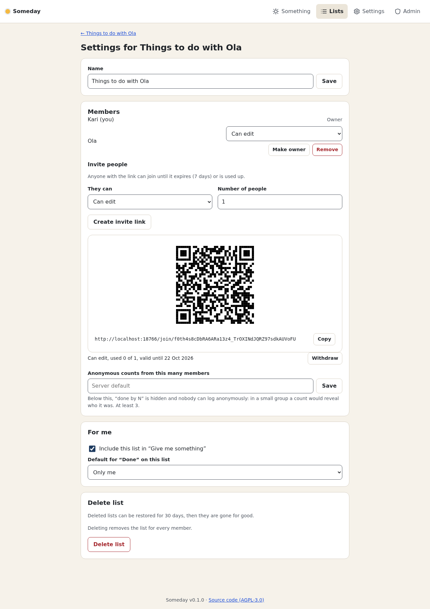

In **List settings**, create an invite link (with a QR code) and choose whether people may edit or only view. Someone without an account can create one right from the link. The owner changes roles, removes members, hands the list over, and decides from how many members anonymous counts are shown. Members can leave. Deleted lists can be restored for 30 days.

## Your devices

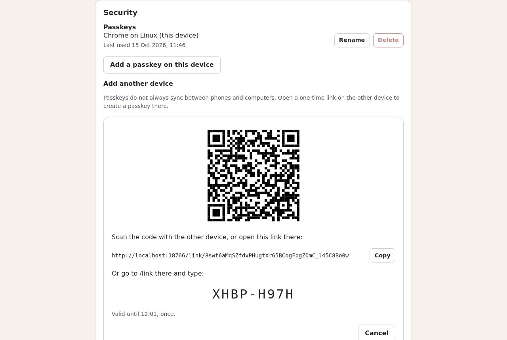

Someday uses passkeys: no passwords, no email. Passkeys do not always move between an iPhone, an Android phone and a Linux laptop, so **Settings → Security → Add another device** gives you a one-time link, a QR code and a short code to type at `/link` on the other device. You confirm with your passkey first; if you like, require approval from this device (you pick the number the new device shows). Every new passkey is announced on your other devices, with **That wasn't me** to remove it at once.

Keep your **recovery codes** somewhere safe: each lets you in once if you lose every passkey.

## Notifications and nudges

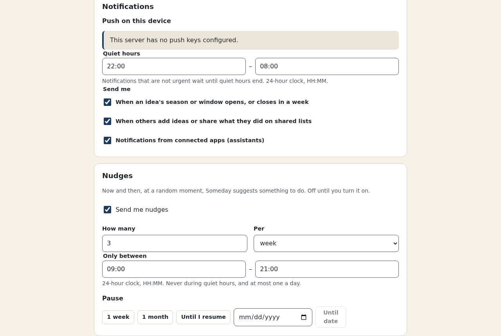

Turn on notifications per device. You can get:

- **Nudges** (off until you turn them on): a few times a week or month, at random moments in your chosen hours, a suggestion. Pause for a week, a month or until a date.
- **Windows**: at 09:00 when an idea's window or season opens, or closes in a week.
- **Shared lists**: when others add ideas or share what they did (at most one notification per list per half hour; private and anonymous entries never notify).
- **Connected apps**: messages from assistants you connected.

Nothing but security notices arrives during your quiet hours (22:00–08:00 by default); the rest waits until morning. On iPhone and iPad, notifications need Someday added to the home screen.

## Phone, dark mode, Norwegian

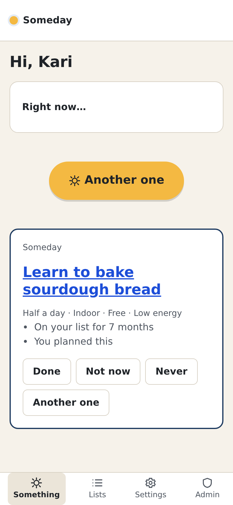
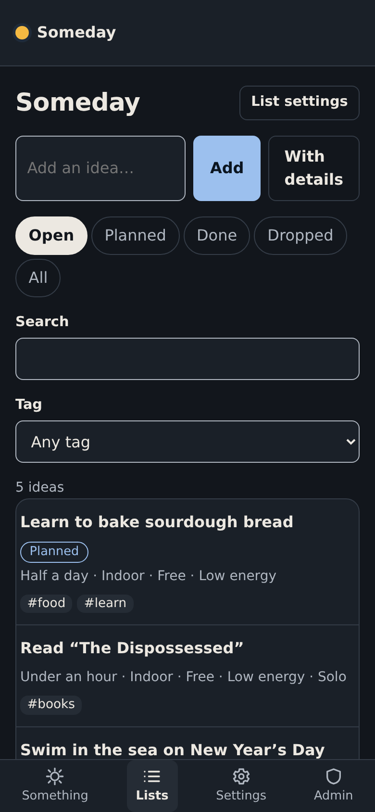
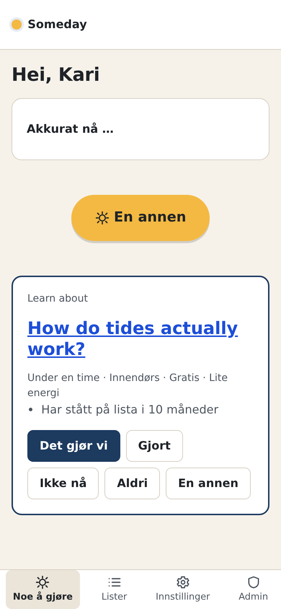

Install Someday from the browser menu (Add to Home Screen) to use it like an app. It follows your system's dark mode, and speaks English and Norwegian (Settings → You → Language).

## Assistants

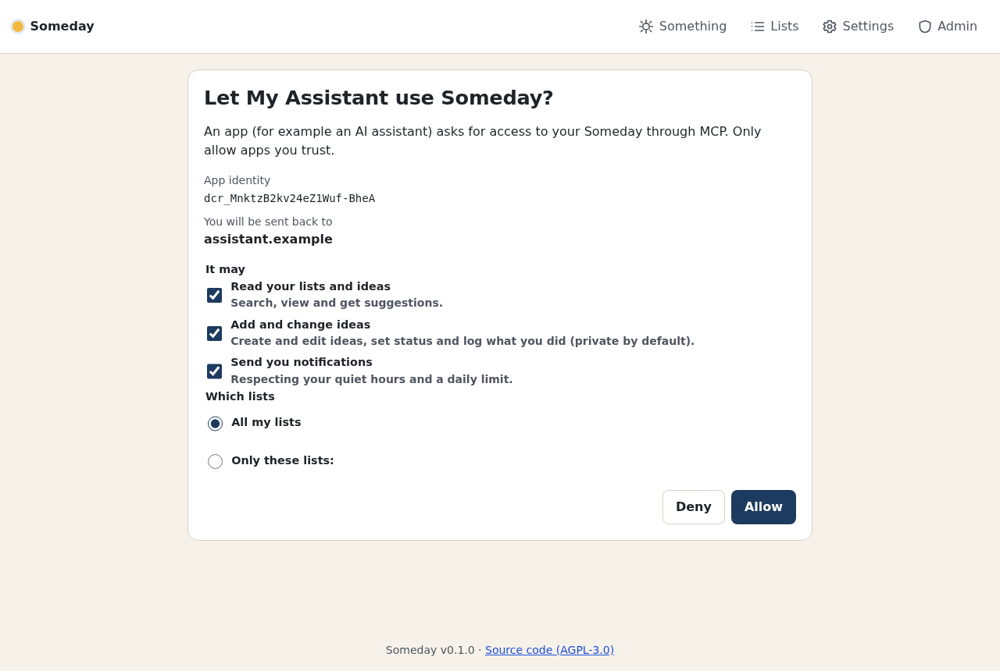

Assistants can use Someday through MCP: see [Connecting assistants](mcp.md).

## Your data

**Settings → Your data → Download** gives you everything as JSON and readable Markdown. **Import** takes such a file (also from another Someday) and shows what it will add before doing it. **Delete my account** logs you out everywhere at once; shared lists you own are handed over or deleted as you choose, and everything is gone for good after 30 days.
